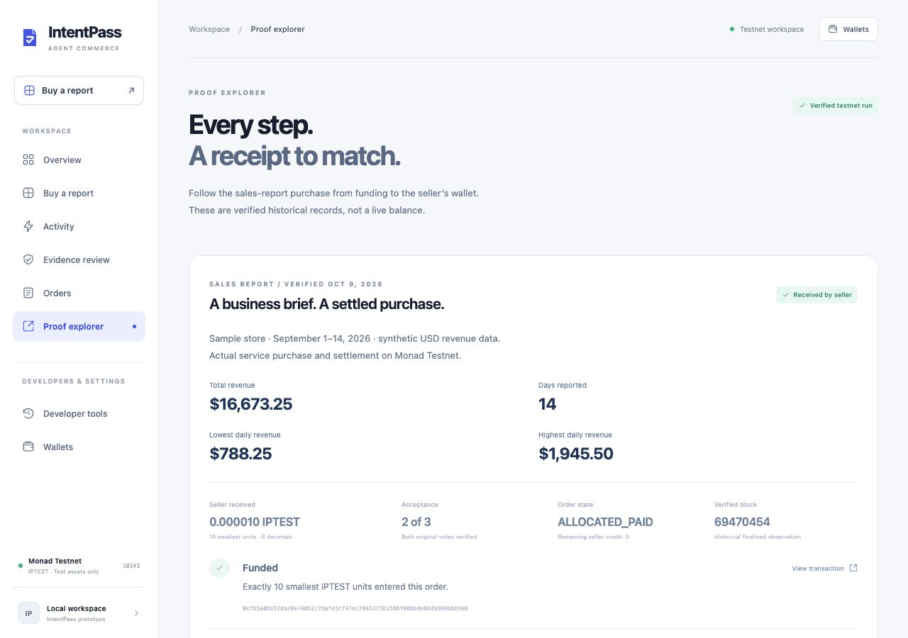

# IntentPass

**Your agent buys. You set the terms.**

IntentPass enables AI agents to purchase data and reports, check usage-rights evidence, verify delivery, and settle payments onchain.



## The problem

An agent finding a service is not enough to complete a trustworthy purchase. The offer must match the user's request, its evidence must support the intended use, and the delivered result must meet the agreed terms before payment is released.

IntentPass connects those checks in one workflow: **request → offer → evidence review → task-scoped authorization → delivery verification → settlement**.

## Try the product

Use **Node.js 24** and **pnpm 11.25.0**. From this folder:

```sh
pnpm install --frozen-lockfile
cp .env.example .env
pnpm build
pnpm start
```

Open **http://127.0.0.1:3000/#overview**. No credentials are needed to explore the interface, import sales data, compute the preview, or view the recorded public transaction trail. Protected model, wallet, and procurement actions require your own configuration and stop when it is missing. Do not overwrite an existing configured `.env`.

1. Open **Buy a report** and use the sample store or import [the sample CSV](examples/sales/sample-sales.csv).
2. Inspect the daily sales chart and the four exact report metrics.
3. Try the incorrect-total example, then verify a matching report.
4. Open **Proof explorer** to inspect the completed testnet purchase and its transaction links.

The preview is an unsigned local calculation. It does not create a purchase or call a model. See [configuration](docs/configuration.md) for live integration requirements.

## A real testnet purchase

A store owner purchases a commercial-use report covering 14 days of synthetic sales. The report contains a day count, total revenue, minimum daily revenue, and maximum daily revenue. IntentPass recomputes these metrics from the committed dataset before acceptance.

| Result | Verified value |
| --- | --- |
| Sales period | September 1–14, 2026 |
| Total revenue | $16,673.25 |
| Acceptance | 2 of 3 committee members |
| Seller received | 0.000010 IPTEST (10 smallest units) |
| Final order state | ALLOCATED_PAID; outstanding seller credit 0 |
| Network | Monad Testnet, chain 10143 |

[View the seller payout](https://testnet.monadexplorer.com/tx/0xe24abcca24dc5e2108d5f8c032feddbcda8ed70dc59784946ba28b22dd9ddc88) · [Read the final chain evidence](artifacts/acceptance/sales-report-purchase/verified-purchase.json) · [Understand the verification scope](docs/verification.md)

This is a real testnet settlement using synthetic business data. Completion required supplementary source-mapping evidence after the first review abstained, followed by reconciliation of an interrupted settlement response. The original review threshold and financial constraints stayed unchanged. This case does not establish uninterrupted unattended execution, source authenticity, or production security.

## Architecture

- **Web workspace:** English interface for sales briefs, evidence review, activity, orders, and proof inspection.
- **Planner and JEV:** a configured OpenAI-compatible planner proposes offers; JEV assesses service, intended-use, and provenance evidence.
- **Privy:** authentication and existing delegated wallet roles; authority remains bound to the user and purchase context.
- **Durable worker:** encrypted local records, persistent queue, original-operation reconciliation, and duplicate-send protection.
- **Monad contracts:** PACT-inspired escrow with task-bound authorization, 2-of-3 acceptance, allocation, and separately verified withdrawal.
- **TypeScript SDK:** authenticated procurement interfaces and an independent public-chain reader.

[Architecture and code map](docs/architecture.md) · [SDK examples](examples/client/README.md) · [Security and scope](docs/security.md)

## Repository map

```text
apps/web/          Product interface and authenticated HTTP APIs
apps/worker/       Persistent workflow and settlement execution
packages/          Protocol, adapters, storage, and automation modules
contracts/         Solidity contracts and native contract tests
examples/          Independent SDK and public-chain clients
tests/             Application and regression tests
fixtures/          Fixed synthetic test inputs
scripts/           Build, verification, and operator utilities
docs/              Reviewer guides and one product screenshot
artifacts/         Curated public proofs and fixed policy test resources
third-party/       Third-party license notices
```

## Checks

```sh
pnpm typecheck
pnpm test:unit
pnpm build
```

Native contract checks use the pinned Foundry toolchain:

```sh
pnpm tools:foundry
pnpm test:contract:monad
pnpm abi:check
```

The default application suite includes one opt-in real-compiler integration test. To include it after installing Foundry and compiling the contracts:

```sh
FOUNDRY_OFFLINE=true INTENTPASS_RUNTIME_ARTIFACT_INTEGRATION=1 pnpm test:unit
```

See [verification](docs/verification.md) for the checks actually run against this review snapshot. Unit tests, native contract tests, and historical public-chain evidence establish different things.

## Scope and license

This is a local testnet prototype. The active product uses IPTEST ERC20 settlement and server-side encrypted workflow storage. Cleanverse and Mera are outside the active product; compatibility modules and regression tests remain in the source. The Mera SDK is a development-only dependency. The escrow is **PACT-inspired**, not Full PACT or IMAS/CDAS.

The independent SDK's next real authenticated procurement and additional policy-denial/refund/compensation evidence remain incomplete. Public hosting and hackathon submission are outside this snapshot. No production audit or complete hackathon acceptance is claimed.

Original code is [MIT licensed](LICENSE). See [attribution](docs/attribution.md) for dependency notices and AI assistance disclosure.
