# Architecture

## Purchase path

```mermaid
flowchart LR
  U[User brief and budget] --> W[Web / SDK]
  W --> P[Planner selects a signed offer]
  P --> J[JEV evidence review]
  J -->|Executable PASS| G[Task-scoped authorization]
  G --> Q[Durable delegated worker]
  Q --> E[Monad escrow funding]
  E --> D[Report delivery]
  D --> V[Recompute metrics / 2 of 3 votes]
  V --> S[Allocate and withdraw]
  S --> R[Verified payout receipt]
```

The sales brief retains the CSV, period, currency, integer-cent denomination, and source/dataset hashes in its evidence commitment. `packages/protocol/src/sales-brief.ts` handles strict parsing; `report.ts` computes the four agreed metrics. The sample uses synthetic sales, not actual customer records.

`apps/web/src/services/propose.ts` and `review.ts` connect planning and evidence review. Review results are PASS, ABSTAIN, or REJECT. An evidence review alone does not authorize payment. Evidence revisions require a new bound context rather than changing a previous result.

`apps/worker/src/background-procurement.ts` orchestrates the purchase. `procurement-runtime.ts` supplies the real role sessions and ports; `workflow-vault.ts` persists encrypted records. `packages/storage` retains reservations and original transaction hashes across restarts. An unknown outcome is reconciled before another action is considered.

`contracts/src/ContextVoteEscrow.sol` enforces the context-bound purchase and committee settlement. `FixedAssetEligibility.sol` binds the test asset; `IntentPassDemoToken.sol` is the test-only IPTEST token. Allocation creates a credit; withdrawal and its actual token transfer are verified separately.

`apps/worker/src/procurement-completion.ts` projects independently verified completion for recovered workflows without rewriting the original failed queue record. The recorded sales purchase used this recovery path.

## Review entry points

| Concern | Start here |
| --- | --- |
| Sales input and exact arithmetic | `packages/protocol/src/sales-brief.ts`, `report.ts` |
| Schemas, hashes and signed context | `packages/protocol/src/index.ts`, `typed-data.ts` |
| Evidence policy | `packages/adapters/src/jev-review.ts`, `review-policy.ts` |
| Background purchase | `apps/worker/src/background-procurement.ts` |
| Durable local execution | `apps/worker/src/workflow-worker.ts`, `packages/storage/` |
| Settlement | `contracts/src/ContextVoteEscrow.sol` |
| Public proof presentation | `apps/web/src/sales-proof.ts` |
| Independent client | `examples/client/`, `examples/chain-client/` |

Legacy browser recovery and Cleanverse compatibility code are retained for regression coverage. They do not define the active purchase route. The live route is the delegated workflow with testnet ERC20 settlement.
